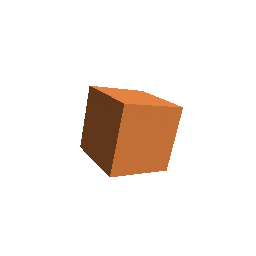
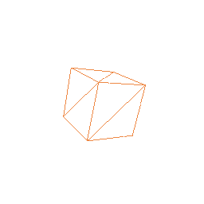

# Draft 3D operations as an opt-in player extension

**Status: experimental.** `:rc-player-3d` plays the ten draft 3D operations from AndroidX
[ag/4108133](https://android-review.googlesource.com/c/platform/frameworks/support/+/4108133)
(`DEFINE_MESH_3D` … `MESH_PRIMITIVE_3D`, opcodes 110–118 and 120) in `RcComposePlayer`. The engine
is ported from the TypeScript and C++ players in
[camaelon/remotecompose-experiments](https://github.com/camaelon/remotecompose-experiments)
(`players/3D_PLAN.md`), which are in turn ports of the reference `JavaPaint3DContext`.

Nothing changes for a host that does not opt in: a document that uses these opcodes still fails to
decode with `Unsupported operation`, as it does on AndroidX's players.

## Using it

```kotlin
CompositionLocalProvider(
  LocalRcPlayerExtensions provides RcPlayerExtensions(Rc3DExtension(Rc3DOptions()))
) {
  RcComposePlayer(bytes)
}
```

A host that decodes the document itself passes the same extensions to the codec:
`RcDocumentCodec.decode(bytes, extensions.wire)`. `Rc3DDocumentBuilder` writes documents that use
the operations; there is no creation-API support for them, since AndroidX's writer has none yet.

## The extension mechanism

Two layers, both opt-in behind `@ExperimentalRcWireExtension`:

| Layer | Type | What it does |
| --- | --- | --- |
| Protocol | `RcWireExtension`, `RcWireExtensions`, `RcExtensionOperation` | Codecs for opcodes the built-in table leaves free. Registering a built-in or duplicate opcode is an error, so a document never decodes differently depending on which extensions a host installed. |
| Compose | `RcPlayerExtension`, `RcExtensionSession`, `LocalRcPlayerExtensions` | One session per played document that uses the extension. The draw loop hands each extension operation to it in document order, with the `DrawScope`, the player state and the current paint. |

Values an extension reads through `RcPlayerState.resolve` are tracked like the player's own reads,
so a camera that follows the clock or a named value redraws with it, and one that does not is drawn
once. `RcExtensionDrawScope.size` is the area the drawing covers in the document's own units, so a
document with a scaling `ROOT_CONTENT_BEHAVIOR` scales its 3D with its 2D. An extension writes variables with `RcPlayerState.setFloat` (`VECTOR_EXPRESSION` does), and
later operations in the same pass read them.

Limit: extensions apply to the top-level operation stream. Bodies the runtime decodes later (macro
and referenced-operation blobs) see only the built-in table.

## Rendering, and where the GPU comes in

Every operation runs through one engine (`RcSoftware3D`): camera, model matrix, lights, material
and the mesh cache. A `DRAW_MESH_3D` is then drawn by one of two rasterizers, chosen per draw by
`Rc3DOptions.renderer`:

| Renderer | How | Depth |
| --- | --- | --- |
| Software | The reference's 28.4 fixed-point rasterizer into an ARGB buffer, composited after each mesh so 3D interleaves with 2D in document order | Per pixel |
| GPU | Transform, lighting and culling on the CPU (the same code), then a back-to-front triangle list through the platform's `drawVertices`: `android.graphics.Canvas` on Android, Skia on desktop, iOS, macOS and Wasm | Painter's sort per triangle |
| GPU, shader mesh (Android 14+) | A convex mesh is uploaded once per geometry version as an `android.graphics.Mesh`; a vertex shader projects, culls and lights it each frame from uniforms | None needed: a convex mesh's visible faces never overlap |

`Auto` uses the GPU wherever it gives the same picture. Every accelerated mode goes through the
GPU, and so does a software mode for a convex mesh that is alone in its depth pass: back faces are
culled, so a convex mesh's visible faces never overlap and there is nothing for depth to resolve.
Wireframe, a non-convex mesh (a torus) and a pass with several meshes keep the software
rasterizer's depth buffer. The two agree pixel for pixel on a convex shape except along its
antialiased silhouette (`Rc3DRenderTest`). `Software` and `Gpu` force one or the other.

What keeps a steady scene cheap: a parametric primitive or expression surface is rebuilt only when
the values it was built from change; a texture is read back once per bitmap; the software frame
bitmap, the GPU path's paint, texture shader and vertex arrays are reused across frames. The
software rasterizer tracks the rectangle each mesh touched, and only that rectangle is cleared,
converted, uploaded and composited, so a small mesh in a large viewport costs its own area.

The software buffer is the canvas's own pixels (times `pixelScale`), not the document's units, so
a document scaled up by its root content behavior is rasterized sharp rather than stretched.

On the desktop test harness (CPU Skia, whose own floor is about 12 ms per render at 1024 px), these
took a software-mode cube from 23.3 to 13.5 ms per render, a small cube forced through software
from 24.3 to 12.2 ms, and a torus forced through software from 24.2 to 16.8 ms.





### The Android shader mesh

On a hardware canvas on Android 14 and later, the GPU path draws a convex mesh through
`android.graphics.Mesh` (`Rc3DShaderMesh.android.kt`). The geometry is laid out once per mesh
version, three vertices per triangle so each carries its face's edges and centroid
(`Rc3DShaderMeshData`). Each frame then sets only uniforms: the model-view and
model-view-projection matrices, up to eight eye-space lights, and the material. The vertex shader
repeats the engine's `projectTriangle` and `litColor`: smooth shading lights each vertex,
flat shading lights the face at its centroid, Lambert is two-sided, and a back face collapses to a
point.

What stays on the CPU path: non-convex meshes, which need the painter's sort; meshes not wholly in
front of the near plane, which the engine clips per triangle; scenes with more than eight lights;
software canvases; Android 13 and earlier; and every Skia target.

Robolectric's host graphics have no meshes, so `Rc3DAndroidMeshDeviceTest` checks it on an API 34
emulator (`.github/workflows/three-d-device-tests.yml`). It draws each scene through both paths on a
hardware canvas and requires the same coverage (within 4%) and colours (a mean difference of at
most 4 levels).

### The Android GLES depth renderer

`Auto` sends a draw that needs depth to the GPU too, on Android 10 and later
(`Rc3DDepthRenderer.android.kt`) and in the browser (below). That is any software-mode draw the depthless paths above cannot
take: non-convex meshes, several meshes in one depth pass, textures, translucency.

- **Rendering.** One EGL context per session renders each mesh into an offscreen framebuffer
  whose 24-bit depth buffer lasts until the document's `CLEAR_DEPTH`, as the software z-buffer
  does. Each mesh's colour is then copied to an `ImageReader` surface and drawn into the canvas
  as a hardware bitmap, so it lands between the 2D drawn before and after it.
- **Shading.** Projection and lighting follow the engine: the vertex shader repeats `litColor`
  from the shader mesh's per-face layout. GL culls on the projected winding, and texture
  coordinates are perspective-correct.
- **Routing.** The first depth-needing draw in a pass picks the renderer for the whole pass, so a
  pass never mixes two depth buffers.
- **What stays on the software rasterizer:** wireframe, whose hidden-line pass is its own; a pass
  that started there; more than eight lights; software canvases; Android 9 and earlier; the Skia
  targets other than Wasm; and `Rc3DRenderer.Software`.
- **Testing.** `Rc3DAndroidDepthDeviceTest` compares it with the software rasterizer on the
  emulator, for a torus, intersecting cubes, a glossy cube and a textured sphere.

### The WebGL2 depth renderer (Wasm)

The same renderer in the browser (`Rc3DDepthRenderer.wasmJs.kt`), routed by the same rules: the
session's up-front read (`gpuDepthTakesEveryDraw`) and the first depth-needing draw of a pass
decide, exactly as on Android, because nothing about the route is different. It takes the draws
that need depth; a lone convex mesh still goes through `drawVertices`, and wireframe, more than
eight lights and `Rc3DRenderer.Software` stay on the software rasterizer.

- **Why a copy.** Skiko draws through a WebGL2 context it does not expose, and a canvas holds one
  context. A second canvas layered over or under Skia's would avoid a copy, but only for a
  document whose 3D is one layer; a mesh, then a label, then a mesh would no longer interleave,
  and the player would need a rule for when layering is allowed. The copy keeps document order
  for every document, so it needs no new rule.
- **Rendering.** A WebGL2 context of the session's own on an `OffscreenCanvas` (a detached
  `<canvas>` where there is none) renders each mesh into a framebuffer whose 24-bit depth buffer
  lasts until `CLEAR_DEPTH`, with the GLSL ES 3.0 programs Android's renderer runs
  (`Rc3DDepthShaders`). The projection is mirrored vertically so GL's rows come out in Skia's
  order, which turns the front face clockwise.
- **The copy.** `readPixels` writes straight into a Skia bitmap's pixels in Skiko's Wasm memory, so
  nothing passes through Kotlin arrays; textures are uploaded from that memory the same way. Only
  the rectangle the mesh's bounding box projects to is read and drawn, so a small mesh in a large
  viewport costs its own area, as on the software path. Drawing the bitmap snapshots it, so one
  bitmap serves every mesh of a frame.
- **Failure.** No WebGL2, a lost context or a shader that does not compile disables the renderer
  for the session, and those draws use the software rasterizer.
- **Testing.** `Rc3DWebGlDepthTest` draws the Android device test's four scenes through both
  renderers and holds them to the same thresholds (coverage within 4%, a mean colour difference
  of at most 6 levels), and checks that depth lasts until it is cleared. It runs in Chromium:
  `./gradlew :rc-player-3d:wasmWebGlTestDist` stages the production-compiled `wasmJs` tests with a
  page of their own, and `scripts/wasm-smoke/three-d-webgl.mjs` opens it (CI's JVM lane runs both).

Measured with that test in headless Chromium on a GPU-less Linux host, where WebGL2 is Chrome's
software GL (SwiftShader), per frame, composite included, the meshes built once:

| Scene | Software, 256 px | WebGL2, 256 px | Software, 768 px | WebGL2, 768 px |
| --- | --- | --- | --- | --- |
| Torus | 8.4 ms | 4.4 ms | 68.8 ms | 26.0 ms |
| Intersecting cubes | 13.4 ms | 2.5 ms | 104.3 ms | 16.8 ms |
| Glossy cube | 6.4 ms | 1.6 ms | 60.0 ms | 10.4 ms |
| Textured sphere | 10.7 ms | 4.6 ms | 81.5 ms | 38.4 ms |

The copy wins even there, where the "GPU" is itself a CPU rasterizer: SwiftShader is native,
vectorized and multi-threaded, and the software rasterizer is single-threaded Wasm. On a real GPU
the draw is cheaper still and the cost is mostly the read's round trip, so these are an upper
bound. Against coverage of 10,000 to 21,000 pixels, the renders differ on 1-2% of them, along
silhouettes, with a mean colour difference of 1.1 to 3.9 levels.

### Next GPU steps, by target

| Target | Next step | Why |
| --- | --- | --- |
| Android (API 34+) | Done for convex meshes: `RcShaderMeshDrawer` | The per-vertex transform and lighting leave the CPU; geometry uploads only when a primitive rebuilds |
| Android (API 29+) | Done: `RcGlesDepth`, GLES into an `ImageReader` surface, drawn with `Bitmap.wrapHardwareBuffer` | A real depth buffer with no CPU copy, still in document order |
| Desktop, iOS, macOS | Skia's mesh API, if Skiko exposes it; otherwise render on Skia's own `DirectContext` | Same as Android `Mesh`; the open question is sharing a texture with Skiko without a copy |
| Web (Wasm) | Done for depth: `RcWebGlDepth`, WebGL2 in a context of its own, read back into a Skia bitmap. Next: zero-copy in Skiko's context, or WebGPU | Zero-copy needs Skiko's own context, which it does not expose; the copy already beats the software rasterizer |

## XR

This is built to fit [compose-ai-tools' Remote Compose in XR](https://github.com/yschimke/compose-ai-tools/blob/main/docs/design/REMOTE_COMPOSE_XR.md)
work, which played a path-drawn cube and a wall card as panel textures. On Android XR there are
four ways to show a 3D document. Each falls back to the one before it, and a host can choose per
mesh draw, not per document.

| Level | What the user sees | How | Per-frame cost | Here |
| --- | --- | --- | --- | --- |
| 1. Flat panel | The document as a card, its 3D drawn flat | `RcComposePlayer` in a `SpatialPanel`, or a hardware canvas on a SceneCore `SurfaceEntity` | One render for both eyes, only when something changed | Works now |
| 2. Stereo window | Depth inside the panel's rectangle | Two renders, one camera per eye, into a side-by-side stereo `SurfaceEntity`; eye cameras from the head pose relative to the panel, through `Rc3DHostCamera` | Two renders, following the head | Host camera is here; the stereo surface host is not |
| 3. Hand-off | Meshes as objects in the room: stereo, occlusion against the room, system lighting | Each mesh built once as a SceneCore `CustomMesh` in a `MeshEntity`, a child of the panel; poses updated from `Rc3DPanelPlacement` each frame. (`Rc3DGltf` writes the same geometry as `.glb` for runtimes that load glTF.) | Pose updates only | Here, in [`rc-player/xr-sample`](../../rc-player/xr-sample) |
| 4. Own renderer | Anything | An OpenXR app rendering each eye itself, through Filament or GLES | All of it | Out of scope |

**Level 3 is the target for rigid meshes, and level 1 the fallback for everything else, per draw.**
SceneCore 1.0 builds a mesh from vertex and index buffers (`CustomMesh`, `MeshEntity`), but the
geometry of a built mesh is fixed and an app cannot free an entity (`Entity.dispose` is
restricted to the library). So:

- A primitive with constant parameters, moved by `MATRIX_3D_OP` or the clock, is handed off. Its
  `Rc3DMeshDraw.meshVersion` stays put and only `model` changes: one entity, moved each frame.
- A mesh rebuilt once (a host value changed its radius, say) gets a new entity; the old one is
  disabled and detached, and goes with the session.
- A deforming mesh (an animated `MESH_EXPRESSION_3D`, a primitive whose radius follows the clock)
  is rebuilt every frame. A new entity per frame would leak one per frame, so once its version has
  changed twice within a few frames (a window, since the player can repaint at the same animation
  time between clock ticks), the host returns true from `Rc3DSceneListener.keepInPlayer` and
  the player draws it on the panel instead (level 1), or a stereo surface would (level 2) for a
  3D-only document.

### The listener contract a hand-off host relies on

`Rc3DOptions(drawInPlayer = false, sceneListener = ...)` keeps the player evaluating the document
(variables, camera, primitive rebuilds, touch) while the host owns the 3D drawing:

- `onDrawMesh` reports each draw as it happens; `onFrame` reports the whole of one component's
  pass once it is drawn. The draws in a frame are exactly what that component shows now: the host
  keeps those and drops any others it held for that component. A static document is drawn once, so
  it costs nothing afterwards.
- `Rc3DMeshDraw.key` (component and position in its pass) is stable from frame to frame while the
  document's structure is: one entity per key.
- `meshVersion` changes exactly when the geometry does: rebuild on change, and treat a version
  that rises every frame as deforming.
- `keepInPlayer(draw)` hands a draw back: the player draws it on the 2D surface even with
  `drawInPlayer = false`. It is how a host declines geometry it cannot take.
- `texture` is the bitmap in effect. A host that needs a file encodes it (as PNG for
  `Rc3DGltf.toGlb`, or for SceneCore's `Texture`); encoding is platform code the player does not
  carry.

### Mapping the document's camera into the room

In XR the eyes are the camera, so the document's camera places the scene instead.
`Rc3DPanelPlacement.panelTransform` treats the panel as a window: the camera's focus plane lies on
the panel, and eye-space units are scaled so the view's height there is the panel's height in
metres. Head-on, the room version lines up with the flat render; moving around reveals the depth.
`Rc3DXrHelpersTest` holds a point on the focus plane to exactly where the flat render draws it.

The panel's physical size is the host's choice. The XR doc's proposed header hints (a preferred
physical size and depth extent) are where a document would state it.

### Input

2D taps keep working through the panel. A tap on a handed-off entity arrives as a SceneCore
interaction hit; the host projects the hit point through the draw's view and projection into the
viewport and feeds it to the document as a touch, so touch expressions (drag to turn, tap to step)
work unchanged.

### What is here, and what is not

- Here: transparent output (`Rc3DRenderTest` asserts the corners stay at alpha 0, as
  `SpatialRemoteComposeTest` does for the path-drawn cube); the host camera; the listener contract
  above; glTF export; panel placement. [`renders/rc-3d-extension/scene.json`](../../renders/rc-3d-extension/scene.json)
  is a SpatialScene with two renders as panel textures, the shape `xr-composite` reads, for
  level 1 previews.
- The sample app, [`rc-player/xr-sample`](../../rc-player/xr-sample): it plays a document with a
  2D card, a rigid cube spun by the clock and a torus whose tube breathes with it. On a headset in
  Full Space the cube becomes a `MeshEntity` in the room and the torus, deforming, stays on the
  panel; anywhere else the player draws all of it on the panel. `RcSceneCoreHost` is the level-3
  host; its mesh packing and deformation rule are unit-tested on the JVM. It has not been run on
  a headset or emulator from this repository's CI.
- Not here: textures on handed-off meshes (SceneCore's `Texture` loads from a file, so the host
  would encode the bitmap first); input on handed-off entities; level 2's stereo surface host;
  level 3 previews in `xr-composite`, which would need mesh or glTF support there.

## Divergences from the reference

- `VECTOR_EXPRESSION` resolves only variables before evaluating. The reference's `updateVariables`
  also replaces the vector opcodes with variable reads, so every vector program evaluates to zeros
  (finding 3 in `3D_PLAN.md`). This follows the experiments repo's players.
- An unset variable reads as 0, as `RemoteContext.getFloat` returns.
- Smooth normals go through the model-view's normal matrix (its inverse transpose), so they stay
  perpendicular to the surface under a non-uniform `M3_SCALE`. The reference transforms them with
  the model-view itself, which bends them and lights a stretched mesh wrongly. Every renderer here
  (software, vertex, `Mesh`, GLES) uses the normal matrix.
- A vector in `VECTOR_EXPRESSION` keeps its lanes past its dimension at zero through every
  operation. The reference applies arithmetic to that padding too, so `length(vec3(1, 2, 3) + 1)`
  is sqrt(30) there and sqrt(29) here; dot, length and normalize all read the padding. A scalar
  still broadcasts across all four lanes.
- Transcendentals use `kotlin.math`, which may differ from glibc in the last bit, so output is not
  promised bit-identical to the C++ oracle on every target. Parity against that oracle's 46 scenes is
  not wired up yet.
