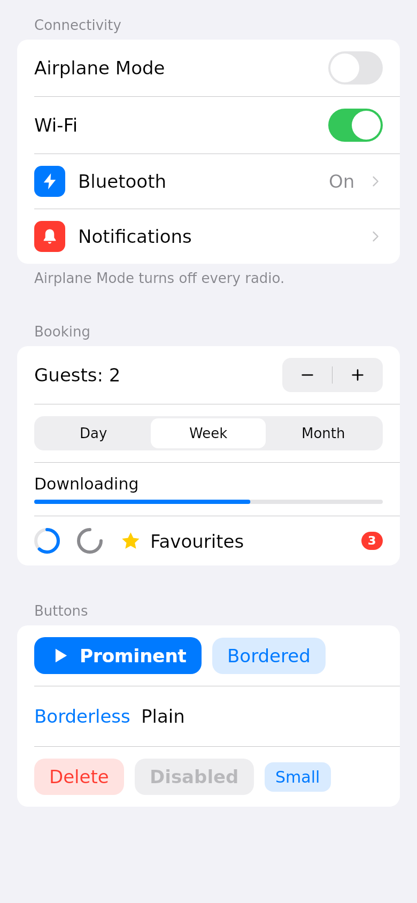
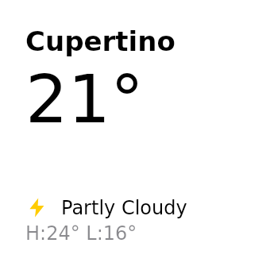
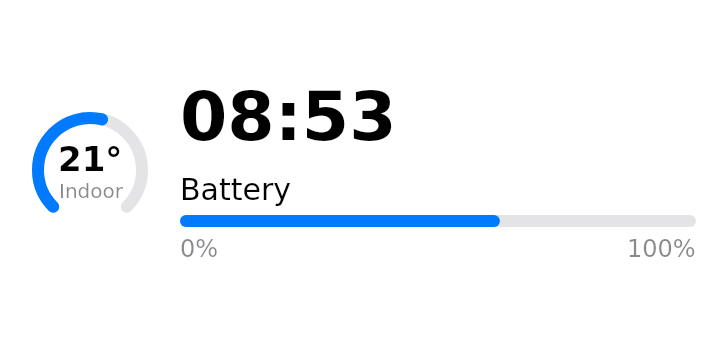
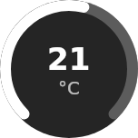
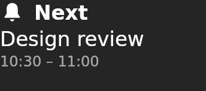

# Apple component libraries (`RcCreationFoundation`, `RcCreationAppleUI`)

Two libraries on [`RcCreation`](RC_SWIFT_CREATION.md) that do for Apple's design language what
AndroidX's `remote-foundation` and `remote-material3` do for Android's:

| Library | Contents | AndroidX counterpart |
| --- | --- | --- |
| `RcCreationFoundation` | Apple's system colours (`.systemBlue`, `.label`, `.secondarySystemGroupedBackground`, …) as light/dark pairs; `RemoteSymbol`, a small set of SF-Symbol-shaped icons drawn as paths; `RemoteIcon`, `RemoteLabel`, `RemoteDivider`; `RemoteButton(_:symbol:action:)` | `remote-foundation` |
| `RcCreationAppleUI` | `RemoteAppleTheme` (`.system`, `.vibrant`); the HIG button styles; `RemoteToggle`, `RemoteStepper`, `RemoteSegmentedPicker`, `RemoteProgressView`, `RemoteGauge`, `RemoteBadge`; `RemoteList` / `RemoteSection` / `RemoteNavigationRow` in the inset-grouped style, scrolling; `RemoteWidget` with WidgetKit's families; `RemoteText.time(_:)` clocks | `remote-material3` |

Everything is written in `RcCreation`'s own operations. A document needs nothing on the player
beyond what any Remote Compose player reads, so the same document plays on the CMP, AndroidX and
native Swift players.

## Example

```swift
import RcCreation
import RcCreationAppleUI
import RcCreationFoundation

let wifi = RemoteVariable("wifi", default: true)
let guests = RemoteVariable("guests", default: 2.0)

RemoteList {
  RemoteSection("Connectivity", footer: "Airplane Mode turns off every radio.") {
    RemoteToggle("Wi-Fi", isOn: wifi)
    RemoteNavigationRow(
      "Bluetooth", symbol: .boltFill, iconBackground: .systemBlue, value: "On",
      action: .host("bluetooth"))
  }
  RemoteSection("Booking") {
    RemoteStepper("Guests: \(guests)", value: guests, in: 1...8)
  }
  RemoteSection("Buttons") {
    RemoteHStack(spacing: 10) {
      RemoteButton("Prominent", symbol: .playFill, action: .host("play"))
        .buttonStyle(.borderedProminent)
      RemoteButton("Delete", role: .destructive, action: .host("delete"))
        .buttonStyle(.bordered)
    }
  }
}
```

Toggles, steppers and segmented pickers change their variables in the document, with no round
trip to the host. Buttons and rows run actions, which can tell the host.

Rendered by the CMP player from [`renders/swift-creation/apple/`](../../renders/swift-creation/apple/)
(the source is `Demo.swift.txt` there):



| `systemSmall` | `systemMedium` | `accessoryCircular` | `accessoryRectangular` |
| --- | --- | --- | --- |
|  |  |  |  |

## Decisions

- **One `RemoteButton`, styled from the environment, as SwiftUI does it.** `RcCreation` owns the
  button itself:
  - `RemoteButton`, `RemoteButtonRole` and `RemoteControlSize`;
  - the `RemoteButtonStyle` protocol;
  - `.buttonStyle(_:)`, `.disabled(_:)` and `.controlSize(_:)`, which are environment values.

  `RcCreationAppleUI` adds `.borderless`, `.bordered` and `.borderedProminent`. They read the
  theme, the tint and the control size, so `.buttonStyle(.bordered)` on a section styles every
  button in it. A custom style is a `makeBody(configuration:)`, as in SwiftUI. The core default
  is `.plain`, because without a theme the core has no tint to draw `.borderless` in. Apple UI
  documents pick their style.
- **Theme from the environment.** `RemoteAppleTheme.system` gives iOS's colours, each an adaptive
  light/dark pair. `.vibrant` is white on a dark background, for accessory widgets. Every
  control reads the theme from the environment, so `.appleTheme(_:)` and `.tint(_:)` restyle
  everything below them.
- **Widgets are documents at their family's size.** `RemoteWidget(family:)` is a
  `RemoteDocument` at WidgetKit's point size for that family. It carries the family's corner
  radius and background, and an optional URL it opens when tapped. Accessory families use
  `.vibrant`.
- **Symbols are paths.** `RemoteSymbol` holds about twenty icons drawn as vector paths, shaped
  like their SF Symbols. A document can't name SF Symbols, because a player off Apple platforms
  has no way to draw them.

## Not yet

- Symbols beyond the built-in set, and text fields.
