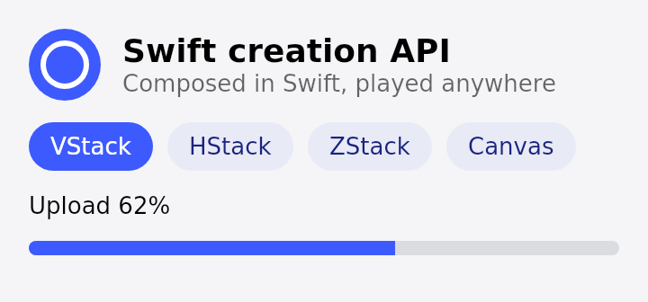
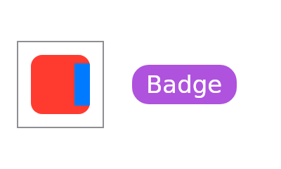
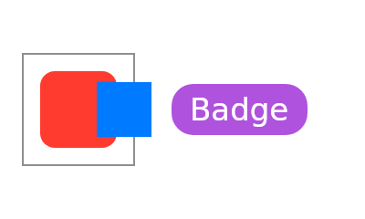

# Swift creation API (`RcCreation`)

`RcCreation` writes Remote Compose documents from Swift. It is the authoring side of the Apple
story: the native Swift player and the XCFramework read `.rc`; this writes it, so a Swift server, a
command-line tool or an app can produce documents without Kotlin.

The API is SwiftUI's: `RemoteView` structs with a `body`, modifiers as methods on any view, stacks
with alignment and spacing, points, string interpolation, accessibility modifiers, adaptive colours
and text styles. Every operation it writes is a `WireOperation` from the generated
[`RcWireOperations`](RC_CODEGEN.md) bindings, so no wire value is written by hand.

## Example

```swift
import RcCreation

struct Chip: RemoteView {
  let label: String
  let selected: Bool
  var body: some RemoteView {
    RemoteText(label)
      .font(.footnote)
      .fontWeight(.medium)
      .foregroundStyle(selected ? .white : .hex(0x1A237E))
      .padding(.horizontal, 12)
      .padding(.vertical, 6)
      .background(selected ? .hex(0x3D5AFE) : .hex(0xE8EAF6), in: .roundedRectangle(cornerRadius: 16))
  }
}

let progress = RemoteVariable("progress", default: 0.62)
let subtitle = RemoteVariable("subtitle", default: "Composed in Swift, played anywhere")

let document = RemoteDocument(width: 360, height: 168, displayScale: 2) {
  RemoteVStack(alignment: .leading, spacing: 12) {
    RemoteHStack(alignment: .center, spacing: 12) {
      RemoteCanvas { context, size in
        context.fill(.circle(center: size.center, radius: 20), with: .hex(0x3D5AFE))
        context.stroke(.circle(center: size.center, radius: 12), with: .white, lineWidth: 3)
      }
      .frame(width: 40, height: 40)

      RemoteVStack(alignment: .leading) {
        RemoteText("Swift creation API").font(.system(size: 18, weight: .bold))
        RemoteText("\(subtitle)").font(.system(size: 13)).foregroundStyle(.secondary)
      }
      .flexWeight(1)
    }
    .frame(maxWidth: .infinity)

    RemoteHStack(spacing: 8) {
      RemoteForEach(["VStack", "HStack", "ZStack", "Canvas"].enumerated()) { index, label in
        Chip(label: label, selected: index == 0)
      }
    }

    RemoteText("Upload \(progress * 100, decimals: 0)%").font(.system(size: 13))

    RemoteZStack(alignment: .leading) {
      RemoteColor.adaptive(light: .hex(0xDADCE0), dark: .hex(0x3A3A3C))
      RemoteColor.hex(0x3D5AFE).frame(width: progress * 328)
    }
    .frame(maxWidth: .infinity, height: 8)
    .clipShape(.roundedRectangle(cornerRadius: 4))
    .accessibilityLabel("Upload progress")
    .accessibilityValue("\(progress * 100, decimals: 0) percent")
  }
  .padding(16)
  .frame(maxWidth: .infinity, maxHeight: .infinity)
  .background(.adaptive(light: .hex(0xF5F5F7), dark: .hex(0x1C1C1E)))
}
let bytes = try document.encode()
```

Rendered by the CMP player (`remote-compose-player --render-png`), from
[`renders/swift-creation/card.rc`](../../renders/swift-creation/card.rc):



The host then writes `progress` and `subtitle` by name, and the player updates the bar, the
percentage and the subtitle without a new document. The canvas draws relative to its own size,
which the player supplies as it lays the canvas out.

## What it covers

| Area | API | Operations written |
| --- | --- | --- |
| Document | `RemoteDocument(width:height:displayScale:accessibilityLabel:)`, `encode() throws(RemoteEncodingError)` | modern `Header` with `DOC_WIDTH`, `DOC_HEIGHT`, `DOC_DENSITY_AT_GENERATION`, `DOC_CONTENT_DESCRIPTION` |
| Stacks | `RemoteVStack`, `RemoteHStack` (alignment, spacing, distribution), `RemoteZStack` (alignment), `RemoteSpacer`, `RemoteForEach` | `ColumnLayout`, `RowLayout`, `BoxLayout`, `LayoutContent`, `ContainerEnd` |
| State layouts | `RemoteSwitch` over a `RemoteBool`, a `Bool` variable, a `RemoteStateValue` enum variable or a `RemoteInt` range, written as a Swift `switch` or `if`; `RemoteIf(condition) { } else: { }` | `StateLayout` with one box per state |
| Text | `RemoteText`; `font(_:)` taking a `RemoteFont` (`.body`, `.headline`, …, `.system(size:weight:)`), `fontWeight`, `bold`, `italic`, `foregroundStyle`, `multilineTextAlignment`, `lineLimit`, `truncationMode`, all environment values that reach every text inside | `TextLayout` |
| Environment | `RemoteEnvironmentKey`, `RemoteEnvironmentValues`, `environment(_:_:)`, `RemoteEnvironmentReader`, `tint` | nothing: read while writing |
| Images and paths | `RemoteImage` (a view), `RemotePath` (SVG path data) that a canvas fills or strokes | `BitmapData`, `PathData`, draw ops |
| Drawing | `RemoteCanvas { context, size in … }` with `fill` and `stroke` of rects, rounded rects, ellipses, circles and lines | `CanvasLayout`, `CanvasContent`, `ComponentValue`, `PaintData`, draw ops |
| Colour | `RemoteColorValue` (literal), `RemoteColor.fixed`, `.adaptive(light:dark:)`, `.variable`; a colour is also a view | `ColorTheme`, `ColorConstant`, `NamedVariable` |
| Modifiers | `frame`, `flexWeight`, `padding`, `offset`, `zIndex`, `background`, `clipShape`, `border`, `visibility`, `hidden`, `visible(if:)`, `onTapGesture`; `RemoteButton`; your own with `RemoteViewModifier` and `modifier(_:)` | the matching modifier ops; a rounded `background` as `DrawContentOperation` + `CanvasOperations` |
| Accessibility | `accessibilityLabel`, `accessibilityValue`, `accessibilityRole`, `accessibilityElement(children:)` | one `CoreSemantics` per view |
| State | `RemoteVariable<Double / Int / Bool / String / RemoteColorValue / RemoteVisibility / some RemoteStateValue>` | `FloatConstant`, `IntegerConstant`, `TextData`, `ColorConstant`, `NamedVariable` |
| Conditions | `RemoteBool` and `RemoteInt`: comparisons, `&&`, `\|\|`, `!`, integer arithmetic over variables | `IntegerExpression` |
| Expressions | `+ - * /`, `min`, `max`, `magnitude`, `clamped(to:)` on `RemoteFloat` and on `Double` variables | one `FloatExpression` per expression, in reverse-Polish order |
| Text from values | interpolation: `"\(x, decimals: 2)"`, `"\(variable)"` | `TextFromFloat`, `TextMerge` |
| Actions | `.host(id:)`, `.host(_:value:)`, `.set(_:to:)` on a variable or a state, `.toggle(_:)`, `.increment(_:by:in:)` | `HostAction`, `HostNamedAction`, value-change actions |

## Decisions

- **Points.** Every length is in points. The document is written in pixels at `displayScale`, which
  the header records as the density at generation. A computed length is scaled by an expression,
  so `progress * 328` stays live.
- **Modifiers are methods, outermost first.** As in SwiftUI, `.padding(16).background(.blue)` paints
  the padding, and modifiers apply to your own views as to built-in ones. A modifier on a view
  whose body is several views applies to each, as SwiftUI's do. They are written as Compose writes
  a modifier chain, outermost first, before the view's `LayoutContent`.
- **The tree is static.** A view's type records its children's (`RemoteTupleView`,
  `RemoteConditionalContent`, `Optional`, `RemoteForEach`). The builder folds statements pairwise
  with `buildPartialBlock` rather than with a parameter pack, because a variadic generic type needs
  the Swift 5.9 runtime (iOS 17, macOS 14), above this package's floor. Repetition is
  `RemoteForEach`. Modifiers return concrete types (`RemoteModifiedContent`,
  `RemoteEnvironmentContent`), as SwiftUI's return `ModifiedContent`. The writer is `package`, so
  the public API is views and modifiers only, with no underscored types.
- **Swift names, not Compose ones.** `RemoteHStack` / `RemoteVStack` / `RemoteZStack` rather
  than Row / Column / Box, `RemoteSwitch` rather than `RemoteStateLayout`, `RemoteButton` and
  `onTapGesture` rather than `clickable`, `hidden()` and `visible(if:)` rather than `GONE`. The
  wire names stay AndroidX's. `visibility(_:)` remains for a `RemoteVisibility` the host writes,
  and `flexWeight` has no SwiftUI equivalent, so it keeps its name.
- **Branches the player takes are state layouts.** A Swift `if` or `switch` in a builder runs while
  the document is written. A branch on a value the player holds is a `RemoteSwitch`: its
  closure runs once per state, so the compiler checks the `switch` is exhaustive, and every state's
  view is in the document. It writes AndroidX's `StateLayout`, which the CMP and native players
  both switch on its index.
- **A rounded background draws, it does not clip.** As in SwiftUI, `background(_:in:)` paints
  behind the content and content that overflows still shows. It is written as AndroidX's
  `drawWithContent`: a box whose modifiers are only the `DrawContentOperation` marker, drawing a
  `DrawRoundRect` over its size bound from `LayoutContent`, then `DrawContent`. Modifiers outside
  the background go on a box around it, so nothing moves or shrinks what the background covers.

  | Clipped (before) | Drawn behind (now) |
  | --- | --- |
  |  |  |
- **Invalid states are type errors.** `flexWeight` returns stack content, not a view, so only a
  stack's builder accepts it. Actions write `RemoteVariable`s only, so an expression or a constant
  cannot be a target. A literal colour (`RemoteColorValue`) is the only one with `opacity(_:)`.
  Visibility is an enum. What only encoding can check (two variables with one name and different
  defaults, a font weight outside 1...1000, a non-positive flex weight, an expression longer than a
  `FloatExpression` holds) throws `RemoteEncodingError`; nothing traps.
- **HIG defaults.** Text defaults to the `body` style in the `primary` colour, so it follows the
  reader's text size and appearance. A text style's size is an expression over the player's font
  size (`RemoteContextIds.idFontSize` over `idDensity` and AndroidX's base size of 14), so it scales
  with the reader's setting while the document plays; `.system(size:)` is fixed, as in SwiftUI.
  Text styling is environment, so `.font(.caption)` on a stack styles every text inside it. An
  adaptive colour is a `ColorTheme` with no colour group, so a player takes the fallback for its
  appearance.
- **Declarations come first.** Every value a view reads is declared between the header and the
  root, once per distinct value. Ids are therefore defined before any reader, and the body is only
  layout.
- **Operation shapes follow AndroidX's writer.** A layout is its operation, its modifiers,
  `LayoutContent` and two `ContainerEnd`s; a canvas adds `CanvasContent`, and binds its size to its
  `LayoutContent`, as AndroidX binds a component's size. `TextLayout` is used rather than
  `CoreText` because every player profile reads it.
- **Constants fold.** Arithmetic on two constants is evaluated in Swift and costs the document
  nothing; adjacent constant text in an interpolation becomes one string.
- **One wire layer.** RcCreation depends only on `RcWireOperations`, the generated bindings, and
  writes `WireDocument`. The native player core still has its own decoder; moving it onto the
  bindings is its own change.

## Verification

- `RcCreationTests` (56 tests) opens every document with `NativeSwiftDocumentSession` and checks the
  decoded tree: sizes in pixels, spacing, padding, colours, weights, text, canvas commands, and a
  canvas's live size. It writes variables through the session and checks that the text, width,
  visibility and colours follow them, and that a tap runs its actions. It reads the operations
  back through the bindings to check modifier order, the single `CoreSemantics`, the `ColorTheme`,
  the text-style expression, and that each typed error is thrown.
- `RcWireOperationsTests` writes documents with RcCreation and reads them back through the bindings
  byte for byte, header included.
- The example above renders as shown in the CMP player.
- On Linux CI, `native-core-linux` runs these suites beside the core's, and `swift-format` lints
  the sources.

## Not yet

- Flow, scroll, `CoreText` styling (letter spacing, line height, font axes), animation specs,
  gradients and touch-down/up handlers.
- A rounded background with uneven corners still clips: the wire's `DrawRoundRect` takes one
  radius.
- `frame(maxWidth:)` with a finite cap: `RemoteMaxLength` is the offered space or a fraction of it.
- A SwiftUI `Color` bridge: resolving one needs an environment. `CGColor`, `CGPoint`, `CGSize`,
  `CGRect` and `CGFloat` convert where CoreGraphics exists.
