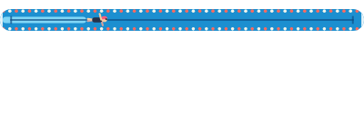

# Android 16: a canvas that reads its measured width

Android's platform widget player (`RemoteViews.DrawInstructions`, what a launcher and SystemUI's
notifications play), run under Robolectric on API 36 (Android 16) and API 37 (Android 17), drawing a
document written by rc-players' creation writer at API level 6 (`RcCaptureProfiles.launcherWidgets`).

Android 16's player draws a canvas that reads its own measured width as nothing when the
`ComponentValue` for that width names the canvas, as rc-players 3.1.0 to 3.1.2 wrote it. The writer now
names the canvas's `CanvasContent`, as AndroidX's writer does. Android 17's player draws either.

## The minimal case

A 300 x 60 px document: a column holding a 24 dp box, holding a state layout (a named flag, baked to
true) whose one branch is a canvas drawing a red rectangle half its own measured width. It is
`PlatformPlayerComponentValueTest` in `:rc-widget-launcher`; the images are
`./gradlew :rc-widget-launcher:testAndroidHostTest --tests '*PlatformPlayerComponentValueTest*' -Prc.render.out=<dir>`.

| | Before (the canvas named) | After (the content named) |
| --- | --- | --- |
| API 36 |  blank: 0 red pixels |  the bar, half the width |
| API 37 |  the bar |  the bar, unchanged |

## Cadence's progress bar

Cadence's `SwimLaneProgress` (its swimmer: a canvas that reads its own width and height, with an
animated clock), in the notification template's structure: a clipped box over a state layout over the
canvas, a named `has_progress` flag and `progress` 0.25 baked in, played as a notification body at
400 x 128 px on API 36. Authored from Cadence's source in a scratch test, which is not committed (it
needs Cadence's drawing files); with the writer before the fix 0 pixels are drawn, after it 9510, the
same as API 37 draws before and after.

| Before | After |
| --- | --- |
|  blank |  the lane and swimmer |
