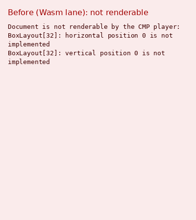
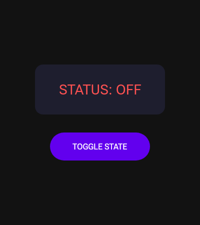
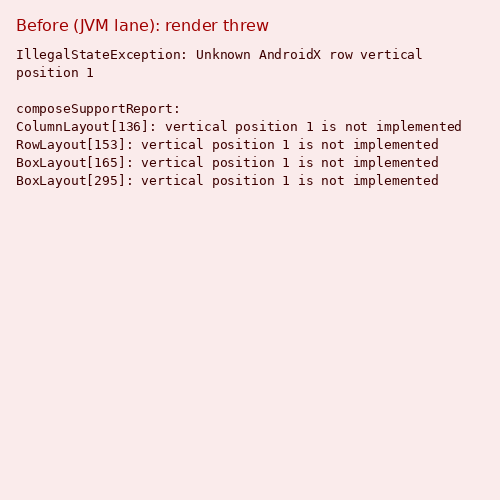
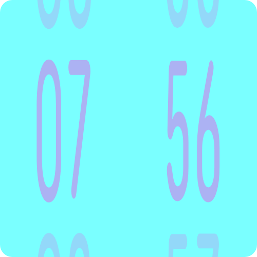

# CMP: out-of-table Box/Row/Column positions place at start/top

AndroidX remote-core's `BoxLayout`, `FitBoxLayout`, `RowLayout`, `ColumnLayout` and `FlowLayout`
position children with `switch` statements whose `default` leaves the offset at 0 (decoded from
`remote-core` alpha19 to alpha21 `internalLayoutMeasure`): Box vertical is `tableswitch 2..5`, so
3 lands on the default too, Box horizontal is `1..3`, Row main is `1..8` with 4/5 on the default,
Column main is `2..8` with 3 on the default. The CMP player threw on these values (JVM/Android:
`Unknown AndroidX box alignment horizontal=1 vertical=1`) or its support check refused the document
(Wasm: `BoxLayout[32]: horizontal position 0 is not implemented`).

Rendered with `RcCmpRenderHarness` at density 1 from `yschimke/RemoteCompose-Examples`
`docs/<group>/<name>/doc.rc`.

| Document | Before | After |
| --- | --- | --- |
| `render/material-toggle-button` (400x450) |  |  |
| `androidx-demos/digital-clock1` (500x500) |  |  |

The "before" images are cards carrying the lane's actual refusal text: the Wasm lane refuses
material-toggle-button through `composeSupportReport` (the JVM lane already drew it, byte-identical
to the after render, because `boxAlignment` treated 0 as unset; only the check was wrong), and
digital-clock1 threw during render.

`advanced-samples/base` and `androidx-demos/demo-bitmap-drawing-bit-draw1` no longer fail on
alignment but stop at unrelated gaps: `Paint command 26 is not implemented by the baseline player`
and `DrawToBitmap references missing bitmap 47` respectively.
