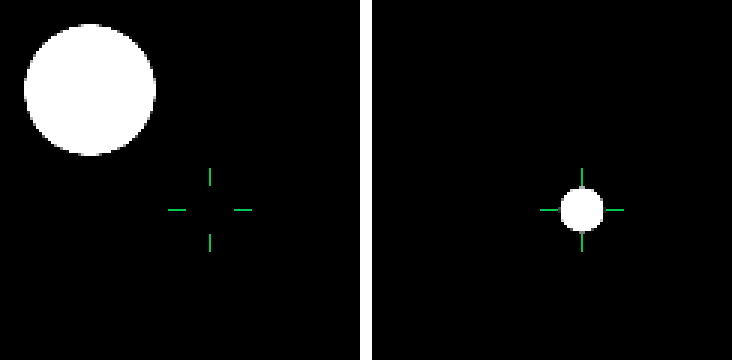
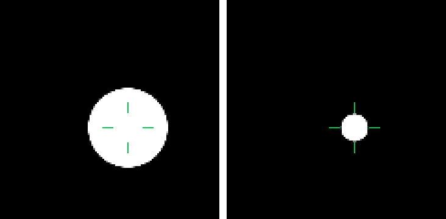

# CMP: a press on a padded component

`remote-core` tests a gesture against the component's whole box and hands it to each click and touch
handler in coordinates that leave out only the padding written *before* that handler
(`ComponentModifiers`; androidx-main `412c1b7bb` made long press, double click and touch cancel
follow click, touch down, up and drag in that).

The CMP player appended its click and touch handlers after every padding of the component, where a
Compose pointer node only sees what lands inside that padding. Two things followed:

- a press in the padding did nothing, whichever side of the handlers the padding was written;
- a press on the content reached a ripple written before the padding in the padded content's
  space, so its wave started short of the finger by the padding.

The handlers now go on before the component's first padding, and their presses reach the ripple
moved by the padding that precedes it. `RcPaddedPressTest` pins both.

A 120×120 black box with 40px of padding all round, 120ms into a press at (70, 70), at 3× with the
ripple's wave brightened. Left: `ripple, click, padding`. Right: `padding, ripple, click`, where the
ripple is inside the padding and so drawn within the content. The green ticks surround the press.

| | |
| --- | --- |
| before |  |
| after |  |

```sh
RC_LAYOUT_EVIDENCE_DIR=<dir> scripts/agent-gradle.sh :rc-player-compose:jvmTest \
  --tests '*RcPaddedPressTest*'
```
