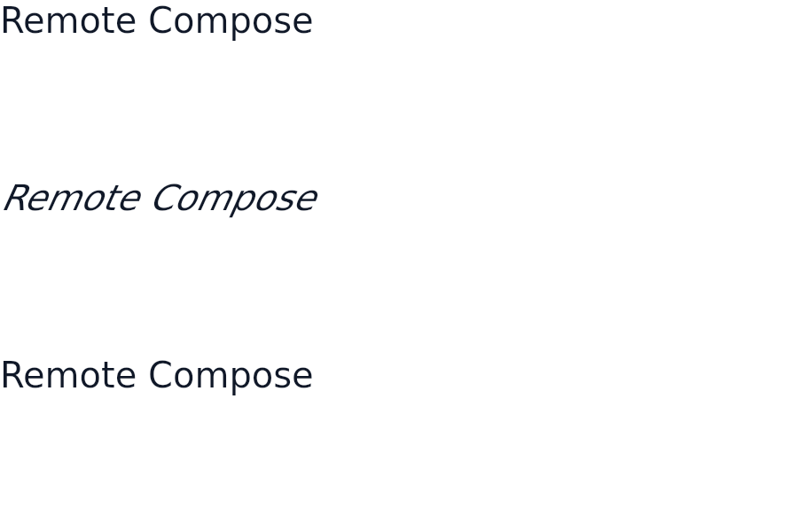
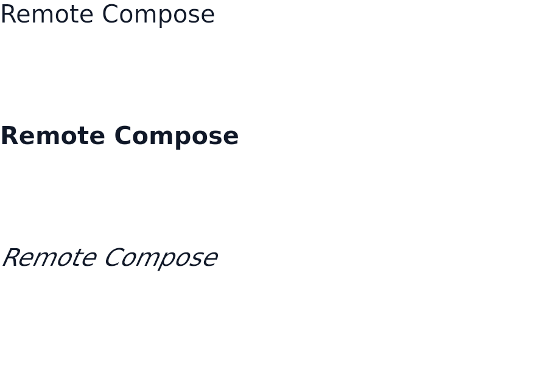

# cmp-text-font-style — the wire font style is an enum, not a Typeface mask

The before/after for the Compose Multiplatform player reading a text's wire font style
(`TextLayout.fontStyle`, `CoreText` style property 6) as an Android `Typeface` style mask: bit 1
forced weight 700 and bit 2 meant italic. AndroidX `remote-core` draws both operations with
`setTextStyle(type, weight, fontStyle == 1)`, and `RemoteFontStyle.Italic` writes 1, so an italic
`RemoteText` drew **bold and upright** here, and a style of 2 drew italic where AndroidX draws
upright.

Each image is one string at a literal 40px, density 2.0, at wire styles 0, 1 and 2, top to bottom:

| style | AndroidX | before | after |
| --- | --- | --- | --- |
| 0 | upright | upright | upright |
| 1 | italic, document weight | **bold, upright** | italic, document weight |
| 2 | upright | **italic** | upright |

| operation | before | after |
| --- | --- | --- |
| `CoreText` |  |  |
| `TextLayout` |  |  |

Regenerate with `RC_LAYOUT_EVIDENCE_DIR=<dir>` set on
`:rc-player-compose:jvmTest --tests '*RcFontStyleRenderTest*' --rerun --no-configuration-cache`
(the environment variable is not a task input, so a cached run writes nothing new);
`RcFontStyleRenderTest`'s assertions pin the same behaviour without the PNGs.
