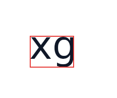

# cmp-text-measure-ink — `TextMeasure` and `TextAttribute` report ink, as the View player does

AndroidX's View player measures a `TextMeasure` / `TextAttribute` run with `Paint.getTextBounds`:
the glyphs' ink, rounded out to whole pixels, unless the op's `TEXT_MEASURE_FONT_HEIGHT` flag asks
for the font's ascent and descent. Since androidx `697c967d0d9` ("Support TextAttribute bounds in
embedded player") the embedded player does the same. The CMP player took each character's line box,
so with no flags its top and bottom were the line's, and its left and right the advance's.

`xg` at 80 px, and a red stroke drawn at the run's measured left, top, right and bottom:

| measurement | before | after |
| --- | --- | --- |
| no flags (ink) |  |  |
| `TEXT_MEASURE_FONT_HEIGHT` |  |  |

Before, both rows draw the same line box. After, the unflagged box hugs the glyphs (`x`'s top,
`g`'s descender, the side bearings trimmed) and the `FONT_HEIGHT` box spans the font's ascent to
descent. `TEXT_MEASURE_SPACES` and `TEXT_MEASURE_MONOSPACE_WIDTH` follow `getTextBounds` too
(`androidXTextBounds`, `RcTextMeasurementTest`).

Compose has no portable glyph-bounds query (Skiko's `getPathForRange` is the selection box), so the
player draws the measured layout once into an offscreen bitmap and scans its coverage
(`RcTextInk.kt`), cached per layout input. `RcTextMeasureInkRenderTest` fails on the old code.

Regenerate with:

```
RC_LAYOUT_EVIDENCE_DIR=<dir> ./gradlew :rc-player-compose:jvmTest --tests '*RcTextMeasureInkRenderTest*'
```
