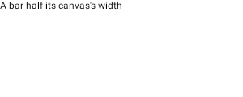
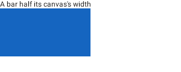
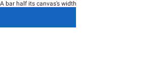
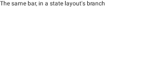
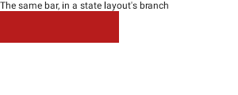

# creation-androidx-player-parity: a canvas's measured size reaches AndroidX's player

Two documents captured with rc-players' creation API (`captureCommonRemoteDocument`, 300 x 120 at
density 1), played by both lanes of `:third-party-rc-embedded-player`'s render harness: `view` is
AndroidX's `RemoteComposePlayer` (the vendored player, under Robolectric), `embedded` is this
repository's player.

- `measured-canvas`: a text, then a 40 dp canvas that draws a bar half its own measured width.
- `measured-in-state-layout`: the same canvas inside a `RemoteStateLayout`'s first branch.

| document | lane | before (3.0.0, `07a8a305`) | after |
| --- | --- | --- | --- |
| `measured-canvas` | view (AndroidX) |  |  |
| `measured-canvas` | embedded |  |  |
| `measured-in-state-layout` | view (AndroidX) |  |  |
| `measured-in-state-layout` | embedded |  |  |

Before, the writer put each `ComponentValue` and the expression that reads it ahead of the root.
AndroidX's player binds a value outside every component only to a component that precedes it, so
the width was never bound and the bar had no size: no bar in the view lane. This repository's player
bound it by id, so the embedded lane drew it all along, which is why the difference went unseen.
After, both are written in the canvas, as AndroidX's writer writes them, and AndroidX's player draws
the bar.

The before documents are 3.0.0's with one change: 3.0.0 wrote no `DOC_PROFILES`, and AndroidX's
player refuses such a document outright ("Unknown operation encountered 239", `CoreText`), so the
header was given `PROFILE_ANDROIDX`, as the consumers that reported this did after capture. A
capture now writes it itself (`profile = RcPlatformProfiles.ANDROIDX`, the default).

What the two lanes still draw differently after the change is not the writer's: AndroidX's player
draws the bar 80 px high where this player draws 40, and in the state layout places the branch at
the column's origin, over the text. `AndroidxPlayerParityTest` (`:rc-creation-coexistence-check`)
compares this library's documents with AndroidX 1.0.0-alpha23's own writer's for a canvas and for a
state layout like these, field for field, and plays both in the same player. Why AndroidX's player
lays these out so was not looked into.

Not shown, because a still image cannot: a slider's touch expression (the drag is asserted in
`AndroidxPlayerParityTest.aSliderSendsWhereItWasDraggedTo`, by the value the player sends), and an inline bitmap, which 3.0.0 wrote as a type AndroidX's decoder refuses
(`anInlineBitmapDrawsInAndroidxsPlayer`).

Regenerate: capture the contents below with `captureCommonRemoteDocument(RemoteCreationDisplayInfo(300, 120, 160)) { … }`
into a directory, as `<id>.rc` beside a `manifest.json` of `{id, width, height, density}`, then run
the harness on it.

```kotlin
// measured-canvas
RemoteColumn(RemoteModifier.fillMaxSize().background(Color.White.rc)) {
  RemoteText("A bar half its canvas's width".rs)
  RemoteCanvas(RemoteModifier.fillMaxWidth().height(40.rdp)) {
    drawRect(
      RemotePaint { color = Color(0xFF1565C0).rc },
      RemoteOffset(0f.rf, 0f.rf),
      RemoteSize(width * 0.5f, height),
    )
  }
}
// measured-in-state-layout: the same canvas (red) as branch 0 of
// RemoteStateLayout(RemoteInt.createNamedRemoteInt("mode", 0), 0, 1, RemoteModifier.fillMaxWidth()),
// with an empty 20 dp box as branch 1.
```

```
scripts/agent-gradle.sh --exclusive :third-party-rc-embedded-player:testDebugUnitTest --rerun \
  --tests '*RcViewPlayerRenderHarness*' --tests '*RcEmbeddedRenderHarness*' \
  -Prc.embedded.input=<dir> -Prc.view.output=<out>/view -Prc.embedded.output=<out>/embedded \
  -Pcomposeai.fonts.cacheDir=$HOME/.cache/composeai/fonts
```

which is what `scripts/rc-lane-ab/render-ab.sh` runs before it scores the lanes against each other.
