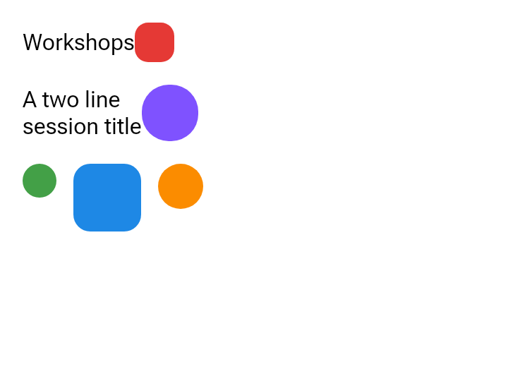
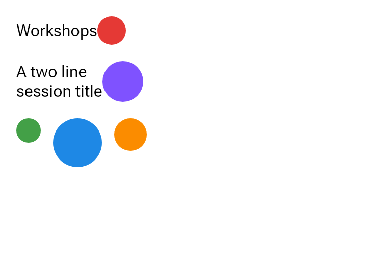

# Component sizes refer to the component a modifier is on

The same document, captured with the fork before (`6f185a2`, androidx-main `a0e84553095`) and
after the refresh to androidx-main `1448d6497`, rendered by `RcCmpRenderHarness` at density 2.

`clip(RemoteCircleShape)` writes its radius as `min(width, height) / density / 2` over the size of
a component. Before, that component was the one recorded before the modifier (`lastComponentId`):
the label before the red 28dp box, the 24dp circle before the blue 48dp one. So a box smaller or
larger than its preceding sibling drew a rounded square. After, the size is the clipped box's own,
through upstream's `RemoteComponentToken` (`ab1b76a2f`), and every circle is round.

| Before | After |
| --- | --- |
|  |  |

The document: a column of `Workshops` + a 28dp circle, two-line text + a 40dp circle, and 24, 48
and 32dp circles in a row.
