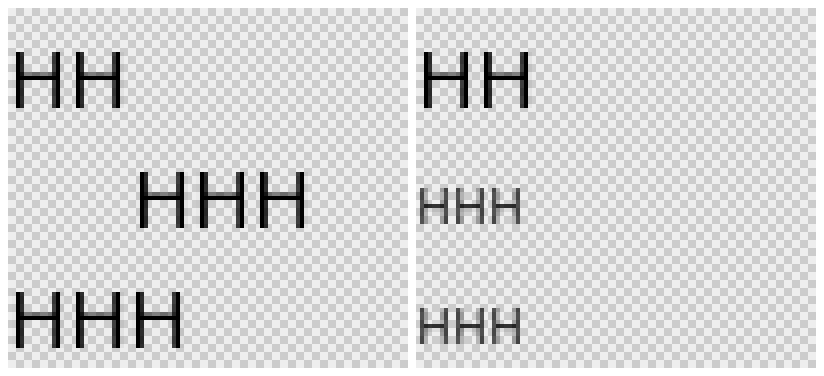
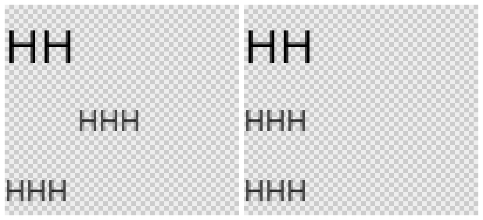

# Creation: measuring text does not change the paint a draw uses

A `RemoteTextMeasurer` measurement writes a paint of its own (the size and weight it measures at)
and then the measurement, at the point in the document where its value is first needed. On a
canvas that is usually between a draw's paint and the draw, and `RemoteCanvas` was not told: text
drawn with a 12 px paint at a position taken from a 20 px measurement was drawn at 20 px, and a
later draw with the same 12 px paint, for which the canvas had nothing to send, was too. The canvas
now sends its paint again, in full, after a measurement that falls in one of its draws, and sends
the next paint in full wherever the measurement fell. AndroidX's `RemoteTextMeasure.kt` is the same
text and has the bug.

Two 100×90 documents from `RcTextMeasurePaintPlaybackTest`, captured with the fork and played by
the CMP player, left to right, at 4×:

1. "HH" at 20 px; under it "HHH" with a 12 px paint, at the x where a 20 px "HH" ends
   (`measurer.measure("HH".rs, fontSize = 20.rsp).size.width`); under that "HHH" at the left edge
   with the same 12 px paint;
2. the same three rows with no measurement, the middle one at the left edge: what 20 px and 12 px
   text look like.

| | |
| --- | --- |
| before |  |
| after |  |

Before, both "HHH" rows of the first document are 20 px text. After, they are 12 px text, and the
middle row still starts where the 20 px "HH" above it ends.

```sh
RC_LAYOUT_EVIDENCE_DIR=<dir> scripts/agent-gradle.sh :rc-player-embedded:jvmTest \
  --tests '*RcTextMeasurePaintPlaybackTest*'
```

writes `text-measure-paint.png`; `before.png` is that file with the fix reverted (the
`onPaintWrittenOutsideCanvas` call in
`third_party/remote-creation-compose/upstream/…/layout/RemoteTextMeasure.kt`).
