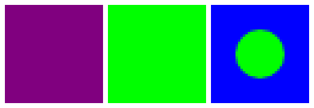

# Creation: `usePaint` writes its paint

`RemoteCanvas.usePaint(paint)` in the creation fork recorded an empty operation, so the paint never
reached the document and whatever was drawn next without a paint of its own was drawn with the
paint before it. That is how `RemotePainter.draw(blendMode, alpha)` applies a painter's alpha and
blend mode, how a colour filter is put over a bitmap, and how `RemoteBasicIcon` resets its tint. It
now writes the paint, as AndroidX's `RemoteCanvas` does.

Three 40×40 documents from `RcCanvasUsePaintPlaybackTest`, captured with the fork and played by the
CMP player, left to right, at 4×:

1. a blue rectangle, then a red bitmap painter drawn with `draw(alpha = 0.5f.rf)`;
2. a blue rectangle, then the red bitmap under `usePaint` with a green `SrcIn` colour filter;
3. a blue rectangle, then `usePaint(green) { drawCircle(null, 10f.rf) }`.

| | |
| --- | --- |
| before |  |
| after |  |

Before, the bitmap is opaque and untinted, and the circle is drawn in the rectangle's blue, so it
cannot be seen. After, the painter is half red over blue, the bitmap is green, and so is the circle.

```sh
RC_LAYOUT_EVIDENCE_DIR=<dir> scripts/agent-gradle.sh :rc-player-embedded:jvmTest \
  --tests '*RcCanvasUsePaintPlaybackTest*'
```

writes `use-paint.png`; `before.png` is that file with the fix reverted.
