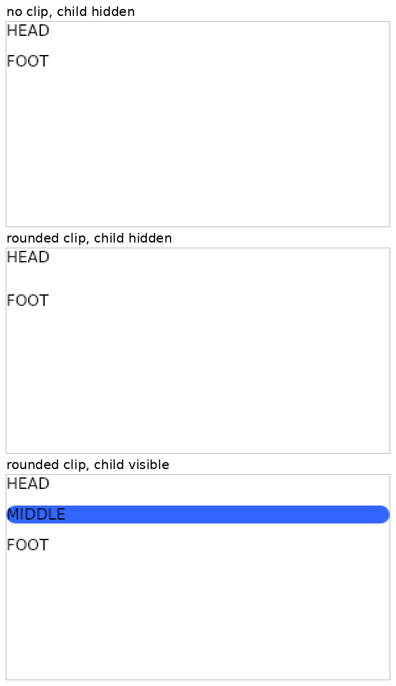
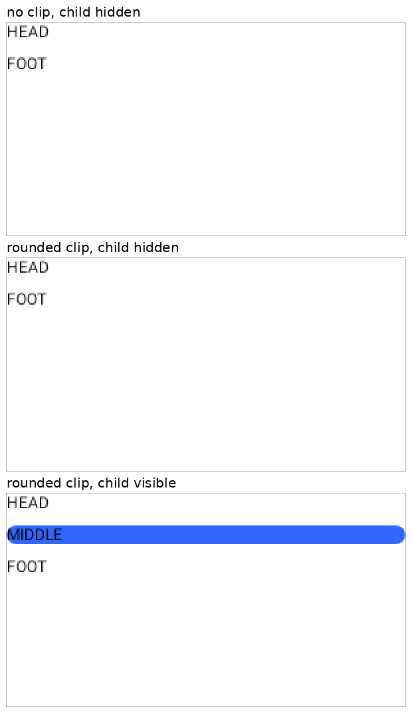

# hidden-clip-layout: a hidden clipped child takes no room

A column with `spacedBy(10.rdp)` holds `HEAD`, a middle column with `fillMaxWidth()`,
`visibility(<named int> > 3)`, a blue background and (in two of the three panels) a
`RemoteRoundedCornerShape(12.rdp)` clip, and `FOOT`. A rounded clip makes the writer emit a
`ComponentValue` for the middle column, which is what used to leave a zero-size child behind in
the Compose player. Each image stacks three panels (300 x 160 px documents, shown at 2x):

1. no clip, child hidden (named int 0)
2. rounded clip, child hidden (named int 0)
3. rounded clip, child visible (named int 5)

| image | player |
| --- | --- |
|  | Compose player at `10afbc38^` (the fix reverted) |
|  | Compose player with the fix (`10afbc38`) |
|  | AndroidX's `RemoteComposePlayer` (View), same `.rc` bytes, under Robolectric |

What to look for: in `before-compose.png` panel 2, `FOOT` sits one spacing (10 px, 20 px at 2x)
lower than in panel 1; the hidden clipped child still took a gap. In `after-compose.png` panels 1
and 2 are identical and match `androidx-view.png`. Panel 3, the visible child with its rounded
corners, is the same before and after, so the fix does not touch the shown case. (The AndroidX
text is a pixel or two narrower: a different font rasteriser, not layout.)

How produced: the document is `RcContent.HiddenClipped(clipped, shown)` from
`rc-creation/coexistence` (`AndroidxContent` has the AndroidX-written twin), captured with
`captureCommonRemoteDocument` at 300 x 160, density 160. The Compose lane played it with
`runSkikoComposeUiTest` + `captureToImage` in `:rc-player-embedded:jvmTest` (the setup of
`RcHiddenClipLayoutTest`); "before" is the same run with the `RcComposePlayer.kt` hunk of
`10afbc38` reverted. The AndroidX lane is `Played(...).frame()` from the coexistence harness
(`:rc-creation-coexistence-check:testAndroidHostTest`). The panels were stacked and scaled 2x
(nearest neighbour) with labels by a throwaway script; the render tests were throwaway too.
`RcHiddenClipLayoutTest` and `AndroidxPlayerParityTest.aHiddenClippedChildTakesNoRoomAsAndroidxPlaysIt`
assert the same thing in CI.
