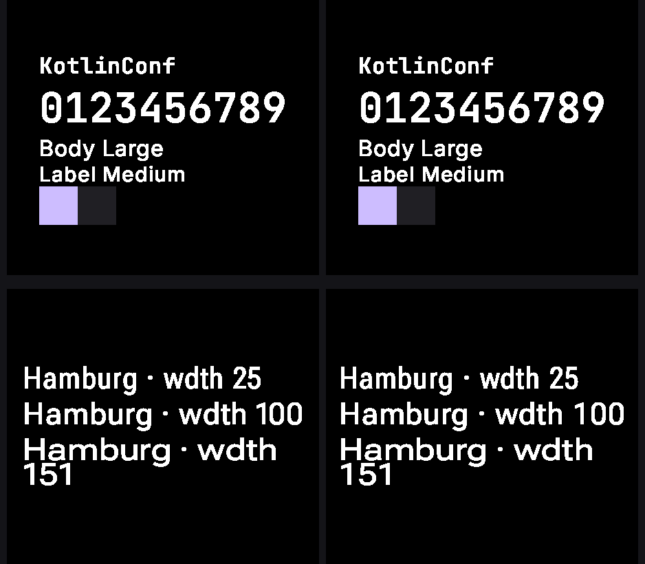

# The `cmp-android` rc-compare lane

`RcCmpAndroidRenderHarness` rasterizes staged `ir/*.rc` through **this** player on **Android**,
under Robolectric, so the `rc-compare` wall can carry a `cmp-android` column beside the two
AndroidX lanes and `cmp-jvm`.

It is the third host of one implementation. [`RcCmpRenderHarness`](../../rc-player/compose/src/jvmTest/kotlin/ee/schimke/composeai/rcplayer/compose/RcCmpRenderHarness.kt)
runs the same player on the desktop JVM through Skiko and `rc-player/wasm` runs it in the browser,
so a difference between this column and `cmp-jvm` is Android's own text and canvas stack rather
than the interpreter.

Until this lane existed `cmp-android` was the only player on the wall with no published column,
even though it is the lane a Wear widget actually ships through — so every `?rcPlayer=cmp-android`
browse on the preview server paid for a live daemon render instead of reading published bytes.

## Driving it

Same contract as its three siblings: an input directory of `<id>.rc` plus a `manifest.json` of
`{id, width, height, density}`, an output directory of `<id>.png`, both named by system property.
The driver stages once and every lane reads the same bytes.

```
./gradlew :rc-player-compose:testAndroidHostTest --rerun \
  --tests '*RcCmpAndroidRenderHarness*' \
  -Prc.cmpandroid.input=<abs dir> -Prc.cmpandroid.output=<abs dir>
```

With nothing staged it yields one skipped placeholder case, so `check` stays green without a
catalog. A document the player cannot render writes `<id>.error` beside the PNGs rather than
failing the run, because "unrendered" is a result the wall reports.

## The lane against the reference

Five `remote-m3` documents staged at their published sizes and rendered through this harness, each
beside the catalog's published `androidx-embedded` render of the same bytes:



Left of each pair is this lane, right is `androidx-embedded`.

| document | size | differs from embedded |
| --- | --- | --- |
| `appcard` | 454×400 | 2.44% |
| `button-filled` | 454×200 | 0.70% |
| `circularprogressindicator` | 384×384 | 0.37% |
| `theme-specimen-kotlinconf` | 454×400 | 0.25% |
| `typeface-variablewidth` | 454×400 | 8.53% |

Share of the frame differing by more than 8/255 on the worst channel. The residue is sub-pixel
placement of whole text blocks, which is the kind of cross-host difference the wall exists to show.

Fonts come from the vendored manifest (`rc-player/wasm/dist-assets/fonts`), the same directory
`RcCmpRenderHarness` loads, rather than from the Google-fonts cache this player uses in the daemon.
Every lane has to shape text with the same faces or the wall attributes a font difference to the
interpreter. `typeface-variablewidth` confirms it: the `wdth` axis is applied and `wdth 151` wraps,
exactly as in the reference.
