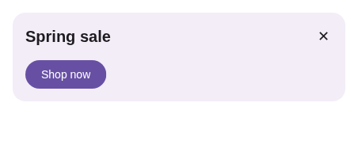
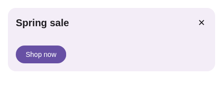

# Empty CoreText retains font height

The sample banner's bound `body` is an empty string. Its CoreText asks for
`TEXT_MEASURE_FONT_HEIGHT` (`PaintContext.ts`, flag 0x02), so its vertical bounds are the font's
ascent and descent even when it has no ink. The early `if (!text)` in `getTextBounds` discarded
that flag and collapsed the body line. Undefined text and empty ink-only measurements still have
zero bounds.

This is the flag contract described in [RC_TEXT_METRICS.md](../../docs/design/RC_TEXT_METRICS.md#the-metric-vocabulary),
not a claim that another player defines correct pixels. The browser test supplies known font
metrics and checks empty/font-height, empty/ink, absent text, and unchanged nonempty cases.

| Before | After |
| --- | --- |
|  |  |

`before.json` / `after.json` are the real player's CoreText layout metrics. With Chromium's font
in this run, only the body changes: 0×0 → 0×16. The headline, close glyph and CTA retain their
measured sizes; the column grows by 16px and the CTA moves down by that amount.

`banner.rc` is Livery's Apache-2.0 sample `samples/catalog/designs/banner-classic/in-app.rc` at
`yschimke/livery@9d5f783e3940e35df603619718bad25553422140`, authored by `SampleBannerTest.kt`.
The capture sizes the canvas before and after loading as `@livery/a2ui` does, then sets the
headline, empty body and CTA through the host named-value API. The before bundle substitutes only
the previous empty-text guard; all other source is the same.

Reproduce after installing `third_party/remote-compose-player` and `scripts/wasm-smoke` npm
packages:

```sh
node renders/ts-empty-font-height/capture.mjs
```

`PLAYWRIGHT_CHROMIUM_EXECUTABLE` selects an installed Chromium; `PLAYWRIGHT_MODULE` optionally
selects an already-installed Playwright package. The capture uses software Canvas2D to keep
rasterization repeatable. The package's `npm test` includes `empty-text.test.ts`.
