# ts-player-refresh-f760e94c — the vendored TypeScript player at camaelon `f760e94c`

`third_party/remote-compose-player/` was refreshed from upstream `c2b2860b` to `f760e94c` by a
three-way merge (see its `PROVENANCE.md`). Besides upstream's own changes, two layout fixes in the
refresh change what the player draws:

- **`widthIn` / `heightIn` are scaled by the density once, not twice.** The modifiers already apply
  the density in `updateVariables`, as the reference's `DimensionInModifierOperation` does, and
  `LayoutManager` then multiplied by the dp scale again. At density 2 every `heightIn(52.dp)` Wear
  button, card and toggle row drew 208 px tall instead of 104. The after geometry matches the CMP
  player's (`renders/native-swift-dimension-in-bounds/button-filled-cmp.png`).
- **An explicit size wins over a weight fill.** Upstream now copies the Java core's
  `isInHorizontalFill()`: a row with a weighted child fills its parent even when it has
  `width(180.dp)`. That is the AOSP view player's full-bleed layout (`renders/rc-cmp-lane-ab/README.md`),
  not Compose's. The fix keeps the exact size, so the split row stays 344 px wide, as in the CMP and
  JS players. The "merge without the fix" column shows what upstream's rule alone drew.

Every document is from `scripts/rc-catalog-corpus/corpus/` (454x400, density 2), rendered in headless
Chromium. Before is the previous `dist/bundle.js`; after is the refreshed one.

| document | before | merge without the exact-size fix | after |
| --- | --- | --- | --- |
| `button-filled` default: `heightIn` double scaling | 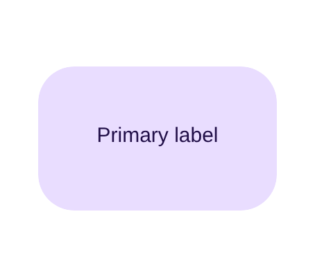 | | 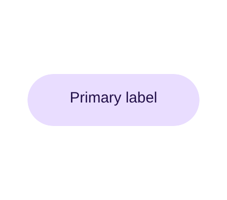 |
| `radiobutton` unselected: height, plus the unselected state upstream now resolves | 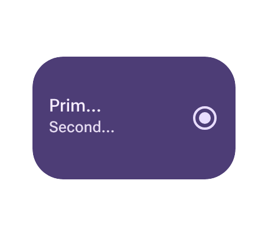 | | 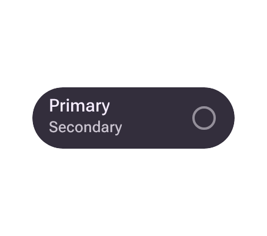 |
| `checkboxbutton` split: height and weight fill | 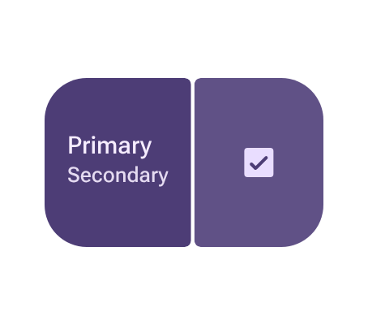 | 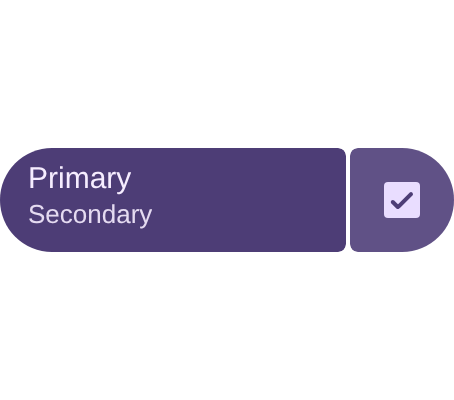 | 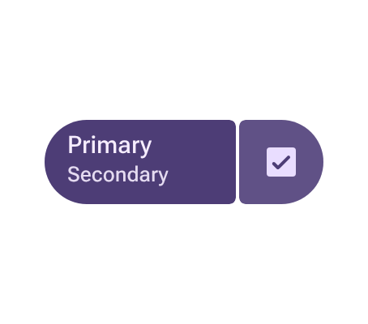 |
| `buttongroup` default: height and weight fill | 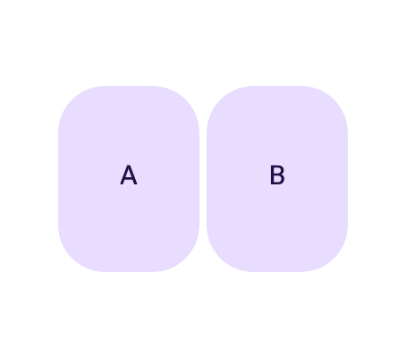 | 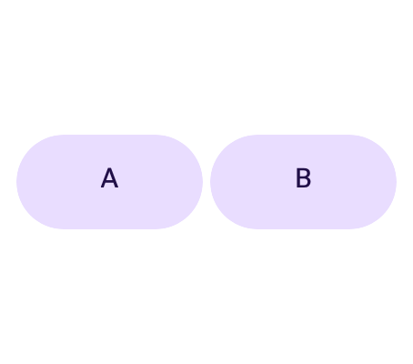 |  |
| `appcard` outlined content image: upstream now draws the image placeholder |  | |  |
| `appcard` gallery-2: upstream's rounded image clips (corner 400 dp, scaled down by Canvas as Skia does) | 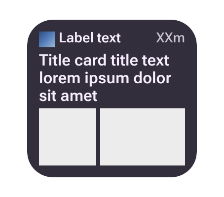 | | 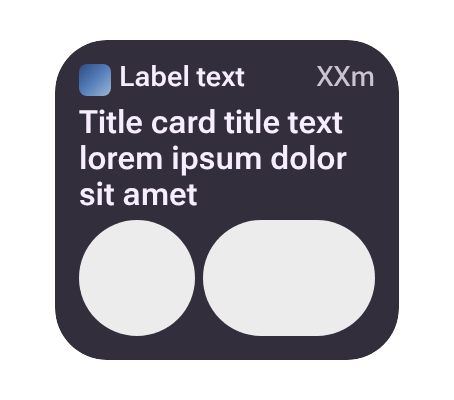 |

Over the whole corpus plus the 11 `Tests/RcNativePlayerCoreTests/Fixtures` documents, 413 of 712
render pixel-identical before and after. None goes blank and none gains a warning or error. The
documents that differ are the `heightIn`-sized Material components (buttons, toggle buttons, cards,
button groups), the title and app cards, sliders, and small (<1.5%) text and indicator shifts.

Regenerate with (from the repository root; the before bundle is the one this change replaced):

```
git show <before-commit>:third_party/remote-compose-player/dist/bundle.js > /tmp/before-bundle.js
PLAYWRIGHT_MODULE=<path to playwright/index.mjs> W=454 H=400 ALL=1 \
  node scripts/ts-player-ab/render-ab.mjs /tmp/before-bundle.js \
  third_party/remote-compose-player/dist/bundle.js <outdir> \
  scripts/rc-catalog-corpus/corpus/<id>.rc ...
```

The script writes `<outdir>/<id>.rc.old.png` / `.new.png` and a `results.json` with the share of
differing pixels per document. Without `ALL=1` it only keeps images that differ by more than 0.5%.
The middle column was rendered from the refreshed source with the two `weightFill` lines in
`LayoutManager.measure` reverted to `weightFillAnyW` / `weightFillAnyH`.
