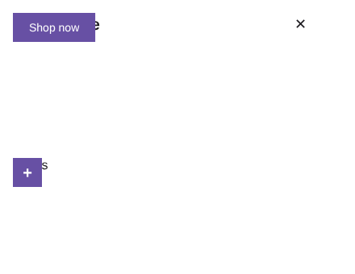
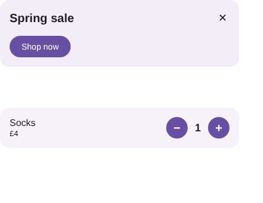
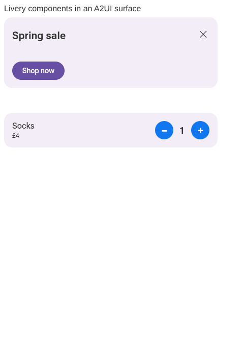

# ts-player-variable-spacing — NaN-boxed `spacedBy` and rounded-clip radii in the TypeScript player

The vendored TypeScript player read a layout's `spacedBy` and a rounded clip's radii as raw floats
and never resolved a NaN-boxed variable id. Compose writes dp spacing and corners as expressions over
the density (`[ID_DENSITY, 16, ×]`), so in these documents every child of a Row or Column was placed
at `NaN`. The container then had no size, so no background and no touch area. Its buttons never fired,
and no corner was rounded. With the fix, the layout is finite and the buttons fire their host named
actions (`dismiss`, `setQuantity`).

The documents are [Livery](https://github.com/yschimke/livery)'s sample catalog templates:

- `banner-classic.rc` (`promo/banner@1`), with headline "Spring sale" and CTA "Shop now";
- `quantity-stepper.rc` (`shop/quantity@1`), with name "Socks", price "£4" and quantity 1.

They are drawn at 400 dp wide, density 1, in headless Chromium. Values are set with
`createHostApi` (`USER:headline`, …) and theme colours as `theme.*` named colours.

| | |
| --- | --- |
| Before (TypeScript player, `main`) |  |
| After (this fix) |  |
| Reference: the CMP Wasm player (Livery's A2UI page, a different frame and theme) |  |
